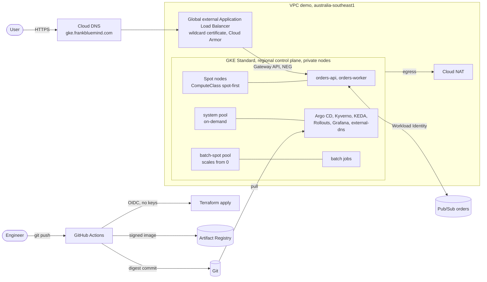

# GKE platform demo

A small, production-style platform on Google Kubernetes Engine. Everything is created from code: Terraform for Google Cloud, GitHub Actions for delivery, Argo CD for the cluster. The sizes are small (2 system nodes); the design is the same as a production platform.

## Architecture



## What is in the repository

| Path | Content |
|---|---|
| `terraform/bootstrap` | APIs, state bucket, GitHub Actions identities (Workload Identity Federation). Applied by an administrator. |
| `terraform/modules/network` | VPC, subnet with Pod and Service ranges, Cloud NAT. Uses Google's `network` and `cloud-router` modules. |
| `terraform/modules/gke` | Cluster, node pools, KMS key for Secret encryption. Uses Google's `kubernetes-engine` private-cluster module. |
| `terraform/envs/demo` | The environment: network, cluster, registry, Pub/Sub, workload IAM, DNS, certificate, Cloud Armor, SLO and alert. |
| `.github/workflows` | `terraform` (check, scan, plan, apply), `terraform-drift` (daily), `app-image` (build, scan, sign, deploy), `scripts` (tests). |
| `gitops/bootstrap` | Argo CD values and the root application (app of apps). |
| `gitops/platform` | One Argo CD application per platform component, plus policies, ComputeClass, Gateway, and the batch example. |
| `gitops/apps/orders` | The demo application manifests. |
| `apps/` | Two Python services: `orders-api` (HTTP, publishes to Pub/Sub) and `orders-worker` (consumes). |
| `scripts/` | Bootstrap, delegation, teardown (Bash) and a cluster health report (Python). |
| `docs/` | Design, enterprise upgrade options, pipeline, and operations notes. |

## Main decisions

| Area | Decision | Reason |
|---|---|---|
| Cluster | GKE Standard, regional control plane, Stable channel, automatic upgrades in a night window | The control plane survives a zone failure; Google tests versions before Stable |
| Access | DNS-based control plane endpoint with IAM; the IP endpoint is disabled | No public control plane address, no bastion host |
| Network | Private nodes, VPC-native, Dataplane V2, default-deny NetworkPolicy, Cloud NAT | No node is reachable from the internet; lateral movement is limited |
| Node scaling | Custom ComputeClass `spot-first` with node pool auto-creation; a tainted `batch-spot` pool for jobs | GKE-native equivalent of Karpenter; Spot first, on-demand when Spot is not available |
| Pod scaling | HPA for the API, KEDA on Pub/Sub backlog for the worker (scales to 0) | Scale on the signal that matches the workload |
| Identity | Workload Identity Federation for Pods and for GitHub Actions | No service account keys exist |
| Ingress | Gateway API, global load balancer, Certificate Manager wildcard certificate (DNS authorization), Cloud Armor | Current Google recommendation; certificate renews automatically |
| DNS | Subdomain delegated from Cloudflare to Cloud DNS; external-dns writes records from routes | No manual records; the parent domain is not touched |
| Delivery | GitOps: the pipeline never runs `kubectl`. It commits an image digest; Argo CD pulls it | The cluster needs no inbound access from CI; Git is the audit log |
| Release | Argo Rollouts canary (20 %, 50 %, 100 %); rollback is a Git revert | Limits the effect of a bad release |
| Supply chain | Trivy scan, SBOM, cosign keyless signature in CI; Kyverno admits only signed images in the app namespace | An image pushed by hand cannot run |
| Policy | Pod Security Admission `restricted`; Kyverno: no `latest` tag, resources required | Enforced at admission, not by convention |
| IaC safety | Plan identity is read-only; apply identity works only from `main`; apply stops when a plan deletes a resource; daily drift check | Least privilege, and no silent destructive change |
| Observability | Managed Service for Prometheus, Cloud Logging, Grafana, one SLO with burn-rate alerts | No self-hosted metrics storage; alerts follow user impact |

## Pipelines

| Workflow | Trigger | Steps |
|---|---|---|
| `terraform` | Pull request, push to `main` | `fmt`, `validate`, tflint, Trivy config scan, checkov, plan (pull request, read-only identity) or apply (`main`). Apply fails when the plan contains a delete; a reviewed destructive plan is run by manual dispatch. |
| `terraform-drift` | Daily, manual | `plan -detailed-exitcode` with the read-only identity. Exit code 2 opens a GitHub issue with the label `drift`. |
| `app-image` | Pull request, push to `main` for `apps/**` | ruff, pytest, hadolint, build, Trivy image scan, SBOM. On `main`: push, cosign signature and SBOM attestation, then a commit that sets the new digest in `gitops/apps/orders`. |
| `scripts` | Changes in `scripts/**` | Python unit tests, shellcheck. |

Scan findings that are accepted have a reason next to them: `.trivyignore`, and `#checkov:skip` comments on the resource.

## How to verify

```bash
gcloud container clusters get-credentials demo --location australia-southeast1 --project gke-platform-demo-dce5 --dns-endpoint
kubectl -n argocd get applications          # all Synced and Healthy
kubectl get nodes -L role,cloud.google.com/gke-spot,cloud.google.com/compute-class
python3 scripts/cluster_report.py           # health report; exit code 0, 1, or 2
curl -s https://orders.gke.frankbluemind.com/version
curl -s -X POST https://orders.gke.frankbluemind.com/orders -H 'content-type: application/json' -d '{"item":"milk","quantity":1}'
kubectl -n orders logs deploy/orders-worker  # the worker starts from 0 when a message waits
```

Policy tests (each is rejected at admission): a Pod in namespace `batch` with image `busybox:latest`, a Pod without resource requests, and an unsigned image in namespace `orders`.

## Operations

| Task | Command |
|---|---|
| First install of Argo CD | `scripts/bootstrap-argocd.sh` |
| Copy Terraform outputs to GitHub variables | `scripts/set-github-vars.sh` |
| Delegate the subdomain at Cloudflare (or `--remove`) | `scripts/delegate-subdomain.sh` |
| New password for the read-only Argo CD account `demo` | `scripts/set-argocd-demo-password.sh` |
| Cluster health report | `python3 scripts/cluster_report.py [--json]` |
| Remove the platform | `scripts/teardown.sh --yes-destroy-demo` |

## Not built

| Item | Reason |
|---|---|
| Distributed tracing (OpenTelemetry Collector, Cloud Trace) | The demo app has no trace instrumentation. The IAM binding for the collector exists in Terraform. |
| Database (Cloud SQL) | Cost. Pub/Sub shows the event-driven path. |
| Staging and production environments | One environment. A second one is a second directory in `terraform/envs` with the same modules. |
| Enterprise controls (Cloud NGFW Enterprise, VPC Service Controls, CMEK, Identity-Aware Proxy, Security Command Center Premium) | Cost. Each one is described in [docs/enterprise-upgrades.md](docs/enterprise-upgrades.md). |

More detail: [docs/gke-design.md](docs/gke-design.md), [docs/app-pipeline.md](docs/app-pipeline.md), [docs/ops-scripts.md](docs/ops-scripts.md).
