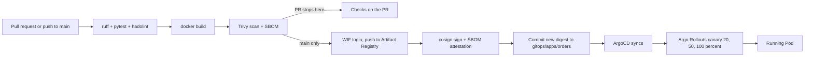

# App pipeline

Two Python services: `orders-api` (HTTP, publishes to Pub/Sub) and `orders-worker` (pulls the subscription). Code is in `apps/`, manifests are in `gitops/apps/orders/`, the pipeline is `.github/workflows/app-image.yml`.

| Control | Risk it covers |
|---|---|
| ruff, pytest | Broken or untested code is merged |
| hadolint | Insecure or sloppy Dockerfile (for example unpinned base, root user) |
| Trivy scan, fails on fixable CRITICAL or HIGH | Known vulnerabilities reach the registry; SARIF in code scanning keeps the history |
| SBOM (CycloneDX), attached as attestation | Nobody knows what is inside an image when a new CVE is published |
| Workload Identity Federation, repo variables only | Stored cloud keys can leak; CI gets a short-lived token instead |
| Least-privilege `permissions:` per job | A compromised step can write to the repo or request tokens it does not need |
| Actions pinned to a commit SHA | A moved or hijacked tag runs attacker code in CI |
| Distroless image, digest-pinned base, non-root | Shell and package tools help an attacker; a moving base tag changes the build silently |
| cosign keyless signature on the digest | An unsigned or swapped image runs in the cluster (Kyverno verifies it; see `gke-design.md`) |
| Deploy by digest, committed by CI | A mutable tag points to a different image than the one that was scanned |
| Pod Security `restricted`, read-only root, no capabilities | A compromised container escapes or changes its own files |
| NetworkPolicy default deny | Lateral movement between Pods; only DNS, Google APIs, LB and metrics are allowed |
| Canary with PodDisruptionBudget and HPA | A bad release hits all users at once; Spot node loss takes all replicas |
| KEDA on Pub/Sub backlog, min 0 | Slow consumers when the queue grows; cost when the queue is empty |
| Direct IAM on Kubernetes service accounts | Shared or over-broad cloud identity; each service has only publish or subscribe |

Limits: the canary has no automatic analysis, so a bad release is stopped by a person or by failing probes. The pushed image is rebuilt with the layer cache after the scan, so it has the same content but is not the same scanned object. Invalid messages are acknowledged and logged, because there is no dead-letter topic.
